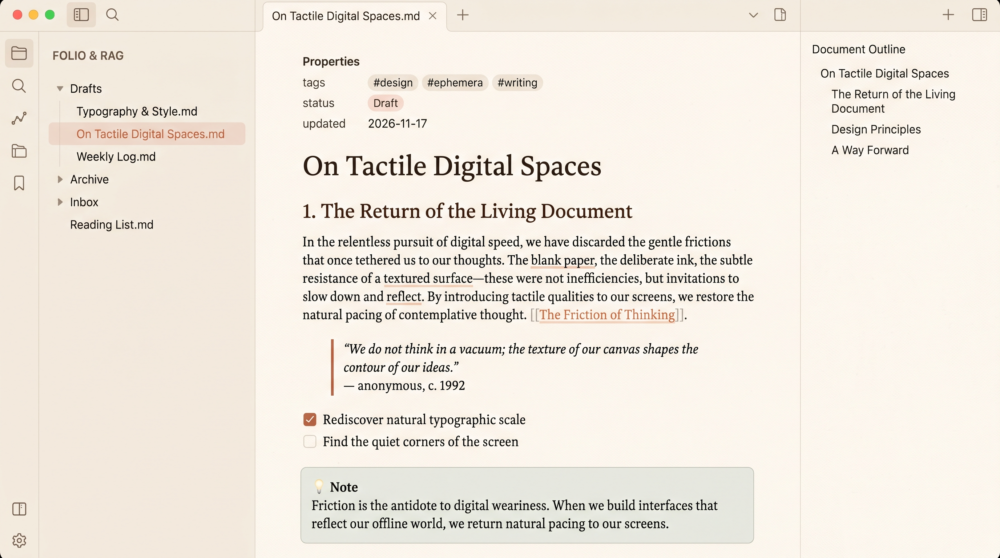

# Folio and Rag

A warm, tactile, paper-inspired theme for [Obsidian](https://obsidian.md), designed for long-form writing, literary note-taking, and calm reading sessions.

## Features

- **Tactile Paper Palettes**:
  - **Light Mode**: Warm Cotton (`#FAF6EE`) default with an optional Sunlit Vellum (`#F5EDE0`) stock.
  - **Dark Mode**: Warm Espresso (`#1E1B17`) low-glare study palette.
- **Editorial Typography**: Optical serif headings and body text paired with clean geometric UI sans-serifs.
- **Style Settings Support**: Customize paper stocks, ink accent swatches (**Terracotta**, **Sage Olive**, **Warm Ochre**, **Slate Ink**, or custom hex), font pairings, reading width, line height, and the subtle paper grain texture directly inside Obsidian via the **Style Settings** community plugin.

## Recommended Fonts

To comply with Obsidian's offline-first policy, **Folio & Rag** does not fetch external fonts over the network. For the intended editorial look, download and install any of the supported font families locally on your device:

- **Primary Pairing**: [Newsreader](https://fonts.google.com/specimen/Newsreader) + [Plus Jakarta Sans](https://fonts.google.com/specimen/Plus+Jakarta+Sans)
- **Alternative Pairings**: [Literata](https://fonts.google.com/specimen/Literata) + [Inter](https://fonts.google.com/specimen/Inter), or [Lora](https://fonts.google.com/specimen/Lora)

If none of these are installed, the theme falls back gracefully to native system serifs (`Iowan Old Style`, `Palatino`, `Georgia`).

## Installation

1. Open **Settings → Appearance → Themes** in Obsidian.
2. Click **Manage**, search for **Folio and Rag**, and click **Install and use**.
3. _(Optional)_ Install the **Style Settings** community plugin to switch paper stocks, ink accents, and font pairings.

## License

MIT License — see [LICENSE](LICENSE) for details.
